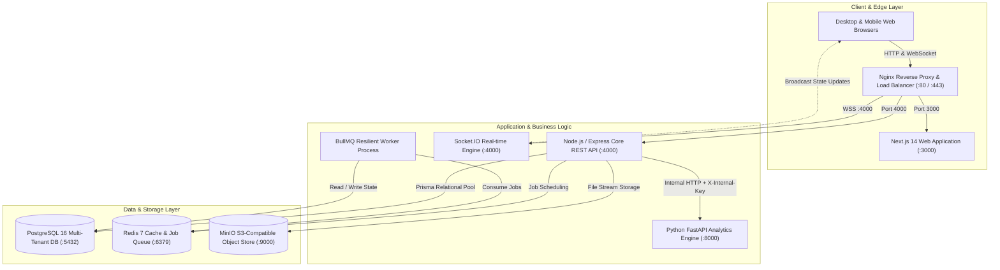
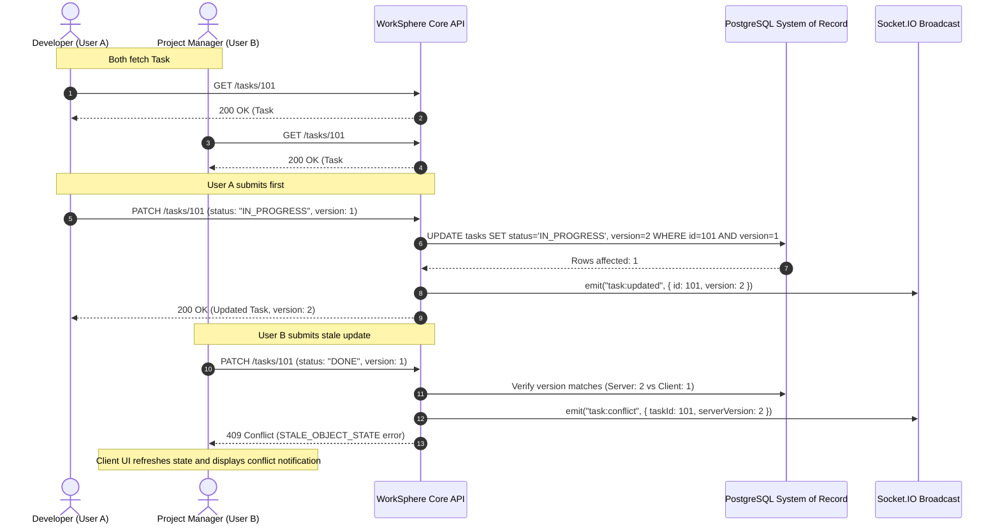

# WorkSphere – System Architecture & Data Flow

## 1. Architectural Overview
WorkSphere adopts a modular service-oriented architecture where:
- **Next.js 14 App Router** handles user presentation, client state management, and real-time UI synchronization.
- **Express.js API** acts as the authoritative primary business gateway and system of record controller.
- **FastAPI Analytics Service** runs independently as a high-performance Python microservice dedicated to statistics, team workload utilization, and chunked streaming exports.
- **PostgreSQL 16** serves as the relational system of record with normalized schemas and tenant foreign keys.
- **Redis 7 & BullMQ** drive background asynchronous job execution, email dispatch, and dead-letter queues.

---

## 2. Component & Network Topology

---

## 3. Data Flow: Optimistic Locking Task Update

The sequence below illustrates how WorkSphere resolves concurrent task updates and prevents silent overwrites:

---

## 4. Service Boundaries & Entity Ownership

| Service | Primary Responsibility | Data Entities Owned |
|---------|------------------------|---------------------|
| **Node.js Express API** | Authoritative business logic, auth, tenant validation, CRUD operations | Organizations, Users, Memberships, Projects, Milestones, Tasks, Comments, Audit Logs |
| **FastAPI Analytics Service** | Stateless computational analytics, metric aggregation, data streaming | Project health scores, workload metrics, cycle time stats, CSV/JSON report exports |
| **BullMQ Worker** | Background asynchronous execution, retry backoff, email delivery | Job events, idempotency keys, dead-letter recovery |
| **Socket.IO Real-time Engine** | Event broadcast, room subscription (`org:ID`, `project:ID`) | Ephemeral client connections and presence state |
