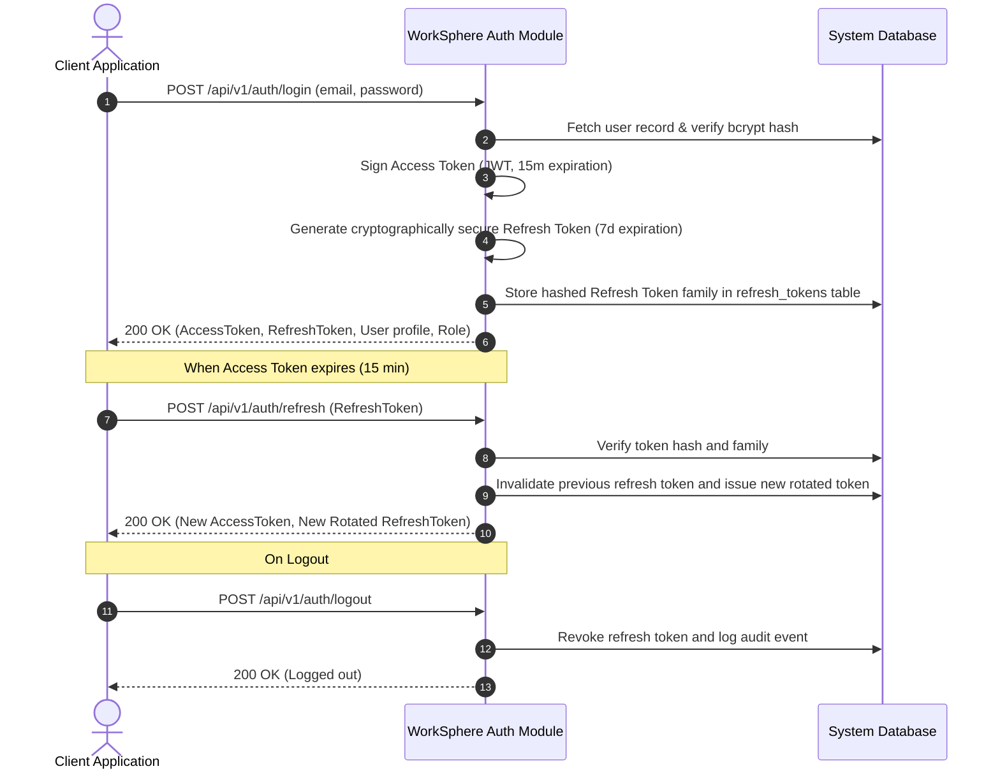

# WorkSphere – Authentication, Authorization & Security Architecture

## 1. Authentication Lifecycle
WorkSphere implements modern token-based authentication with short-lived access credentials and refresh token rotation.

---

## 2. Role-Based Access Control (RBAC) Matrix

Every protected API endpoint enforces role verification on the server:

| Capability / Resource | Platform Admin | Organization Owner | Project Manager | Team Member | Auditor |
|-----------------------|:--------------:|:------------------:|:---------------:|:-----------:|:-------:|
| View All Tenants | ✅ | ❌ | ❌ | ❌ | ❌ |
| Manage Organization Settings | ✅ | ✅ | ❌ | ❌ | ❌ |
| Invite Employees & Manage Roles | ✅ | ✅ | ❌ | ❌ | ❌ |
| Create / Edit Projects & Milestones | ✅ | ✅ | ✅ | ❌ | ❌ |
| Create & Assign Tasks | ✅ | ✅ | ✅ | ✅ | ❌ |
| Move Task Status & Add Comments | ✅ | ✅ | ✅ | ✅ | ❌ |
| Modify Records (Write Operations) | ✅ | ✅ | ✅ | ✅ | **DENIED (403)** |
| View System Audit Logs & Telemetry | ✅ | ✅ | ❌ | ❌ | ✅ |
| Access Organization B Data | **DENIED** | **DENIED (403)** | **DENIED (403)** | **DENIED (403)** | **DENIED (403)** |

---

## 3. Multi-Tenant Record-Level Isolation
Tenant boundary validation is enforced at three distinct layers:
1. **JWT Organization Claim**: Every access token embeds the user's authoritative `currentOrgId`.
2. **Middleware Verification (`requireTenant`)**: The middleware validates that the request context matches the user's active membership. Cross-tenant spoofing attempts in the `X-Organization-ID` header are rejected with `HTTP 403 Forbidden`.
3. **Repository Query Scope**: All queries executing against projects, tasks, milestones, comments, and audit events strictly append `WHERE organization_id = :orgId`. Data belonging to Tenant B is structurally inaccessible to Tenant A.

---

## 4. Hardening & Defensive Controls
- **Helmet**: Disables MIME sniffing, clickjacking, and XSS headers.
- **Express Rate Limiting**: 1,000 requests per 15 minutes globally; 30 attempts per 15 minutes on auth endpoints.
- **Password Protection**: Passwords salted and hashed with bcrypt (10 rounds) or Argon2.
- **Input Sanitization**: All request bodies validated against strict Zod schemas before reaching business logic.
- **File Upload Safety**: Memory buffering with Multer, size restricted to 20MB, path traversal characters (`../`) stripped.
