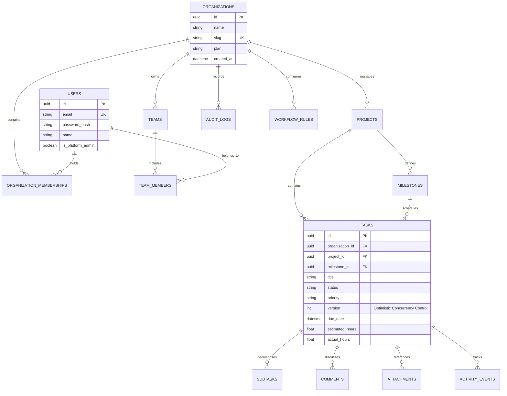

# WorkSphere – Database Design & Relational Schema

## 1. Overview
WorkSphere uses PostgreSQL 16 managed via Prisma ORM. The relational model is normalized to Third Normal Form (3NF), ensuring referential integrity, tenant isolation, and auditability.

---

## 2. Entity-Relationship (ER) Diagram



---

## 3. Concurrency Protection: Optimistic Locking
To prevent silent overwrites in high-concurrency environments:
1. Every `Task` record contains an integer `version` column, initialized to `1`.
2. When a client performs a modification (`PATCH /api/v1/tasks/:id`), it must supply the `version` it intends to update.
3. The database layer executes:
   ```sql
   UPDATE tasks
   SET title = $1, status = $2, version = version + 1, updated_at = NOW()
   WHERE id = $3 AND organization_id = $4 AND version = $5;
   ```
4. If `rows_affected == 0`, the record has been modified by another concurrent transaction.
5. The API raises `OptimisticLockError`, returning `HTTP 409 Conflict` with the current server record.

---

## 4. Multi-Tenant Foreign Key Boundaries & Indexes

| Table | Tenant Foreign Key | Primary Index / Constraints |
|---|---|---|
| `organization_memberships` | `organization_id` | `UNIQUE(organization_id, user_id)` |
| `projects` | `organization_id` | `UNIQUE(organization_id, key)` |
| `tasks` | `organization_id` | `INDEX(organization_id, project_id)`, `INDEX(organization_id, status)` |
| `audit_logs` | `organization_id` | `INDEX(organization_id, created_at DESC)` |
| `workflow_rules` | `organization_id` | `INDEX(organization_id)` |
| `job_events` | N/A (Queue Engine) | `UNIQUE(idempotency_key)` |
