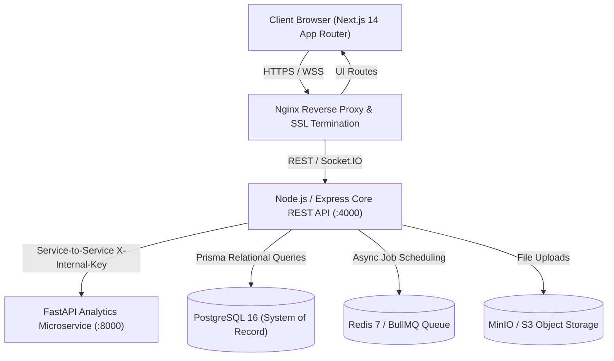

# WorkSphere – Project Overview & Business Scope

## 1. Executive Summary
**WorkSphere** is an enterprise-grade, multi-tenant Software-as-a-Service (SaaS) Project Management and Workflow Automation Platform. It provides end-to-end organizational workspace management, real-time interactive Kanban task boards, milestone tracking, asynchronous notification delivery, automated workflow rules, and dedicated Python workload/cycle-time telemetry.

---

## 2. Core Business Requirements & Tenancy Model
The platform operates on a strict multi-tenant isolation model:
- **Tenant Isolation**: Organization A (e.g. Acme Corporation) and Organization B (e.g. Globex Industries) share compute resources while maintaining strict data boundary separation at the application and database layers.
- **Tenant Context**: All operational requests require an organization context (`X-Organization-ID` or JWT claims). Any request attempting to inspect or modify another tenant's records is rejected immediately with HTTP 403 Forbidden or 404 Not Found.
- **Role Hierarchy**: 5 distinct personas:
  1. `PLATFORM_ADMIN`: Global infrastructure administration and cross-tenant organization directory.
  2. `ORG_OWNER`: Full administrative control over their organization, employee invitations, workflows, and settings.
  3. `PROJECT_MANAGER`: Creates projects, milestones, assigns work, and monitors team velocity.
  4. `TEAM_MEMBER`: Collaborates on tasks, updates statuses, logs hours, and comments.
  5. `AUDITOR`: Strictly read-only compliance access to activity history and audit logs. All modification attempts return HTTP 403.

---

## 3. High-Level Service Distribution

---

## 4. Key Engineering Deliverables
1. **Frontend Architecture**: Responsive Next.js App Router application with role-tailored navigation, TanStack Query, accessible forms, and Recharts visualizations.
2. **Core Backend API**: Modular Express REST API with versioned `/api/v1/` routes, Zod input validation, optimistic locking, and standard error envelopes.
3. **Dedicated Python Microservice**: FastAPI service computing project health, workload utilization, and chunked CSV/JSON stream generators.
4. **Resilient Background Processing**: BullMQ job queue with deduplication and idempotency keys to guarantee zero duplicate notifications upon worker restarts or retries.
5. **Security & Auditing**: Argon2/bcrypt hashing, short-lived JWTs, refresh token rotation, and immutable audit logs.
